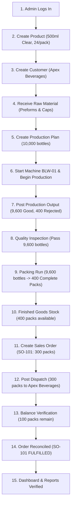

# TCK FactoryFlow — Testing & Verification Plan

---

## 1. Testing Framework & Environment

The verification harness encompasses:
1. **JVM Unit Tests (Android):** JUnit 4, Kotlin Coroutines Test, Room In-Memory Database (`app/src/test/`).
2. **Worker Unit Tests:** Node.js native test runner (`node --test`), `cloudflare-worker/test/`.
3. **Firestore Security Rules Unit Tests:** `@firebase/rules-unit-testing`, Firebase Local Emulator (`rules-tests/`).
4. **Android Build Verification:** Gradle 8.11.1 (`./gradlew test assembleDebug assembleRelease`).
5. **End-to-End Factory Life Cycle Verification:** Complete simulated flow from product creation to customer dispatch.

---

## 2. Test Suites

### 2.1 Backend Tests (`cloudflare-worker/test/`)
- [x] **Value Serialization:** Handle primitive types (integers, strings, booleans, maps, arrays, nulls) into Firestore REST format.
- [x] **Value Deserialization:** Convert Firestore typed maps back to clean JavaScript objects.
- [x] **Custom Claims:** Verify JWT custom attributes payload structure for Firebase Identity Toolkit.
- [x] **Organization Resolution:** Whitelist and resolve valid organization identifiers.
- [ ] **Admin Bootstrap Authorization:** Verify `bootstrap-admin` accepts canonical administrator emails and rejects unauthorized emails with HTTP 403.
- [ ] **Customer Upsert & Archive:** Verify customer document structure, name validation, and soft-archive behavior.
- [ ] **Production Run Idempotency:** Verify that posting identical idempotency key returns cached result without double-counting stock.
- [ ] **Packing Quantities Math:** Verify complete packs and loose bottles calculation across various pack sizes (12, 24, 48).
- [ ] **Dispatch Non-Negative Guard:** Verify dispatch is rejected when requested quantity exceeds available complete packs.
- [ ] **Reversal Compensating Transaction:** Verify dispatch reversal restores complete packs and marks batch as REVERSED.

### 2.2 Android Domain & Logic Unit Tests (`app/src/test/`)
- [x] **Manufacturing Rules Tests (`ManufacturingRulesTest.kt`):**
  - Pack calculation with exact multiples and remainders.
  - Production quantities validation (produced >= good + rejected).
  - Energy consumption calculation (end reading >= start reading).
  - Dispatch remaining stock calculation.
- [x] **Factory Permissions Tests (`FactoryPermissionsTest.kt`):**
  - Owner and Admin have access to all actions.
  - Role restrictions for Storekeeper, Packing Staff, Production Staff, and Viewer.
  - Organization matching validation.
- [ ] **Extended Roles Permissions Tests:**
  - Supervisor: Can manage machines, production plans, and quality inspections; cannot manage staff accounts.
  - Quality Inspector: Can record and view inspections; cannot post production or dispatches.
  - Inventory Manager: Can perform stock adjustments, manage products, view reports.
- [x] **Report Export Tests (`ReportExportTest.kt`):**
  - Date range filtering inclusive boundaries.
  - Totals computation across production, packing, dispatch, and electricity.
  - CSV string escaping and column headers formatting.

### 2.3 Security Verification Tests
- **Invalid Token:** Submit request with corrupted Bearer token -> Expect HTTP 401.
- **Expired Token:** Verify `CloudflareApiClient` triggers token refresh and retries before failing.
- **Unauthorized Role:** Attempt stock adjustment with `viewer` role -> Expect HTTP 403.
- **Tenant Cross-Access:** Authenticated user of Org A requests factory of Org B -> Expect HTTP 403.
- **Inactive Account:** Member profile with `active: false` -> Deny all write and read operations.
- **Direct Firestore Mutation:** Client attempts direct mutation -> Denied by `firestore.rules`.
- **Negative Stock Prevention:** Submit dispatch exceeding available stock -> Expect HTTP 400 with insufficient stock error.

---

## 3. End-to-End Factory Workflow Scenario

This automated and manual validation scenario exercises the full manufacturing life cycle:

### Verification Criteria at Each Stage:
1. **Production:** `unpackedGoodBottles` increases from 0 to 9,600.
2. **Packing:** `unpackedGoodBottles` decreases by 9,600 to 0; `completePacks` increases from 0 to 400.
3. **Dispatch:** `completePacks` decreases from 400 to 100; sales order lines show 300 packs dispatched.
4. **Audit Trail:** Immutable ledger contains all movements with correct timestamps, actor IDs, and quantities.
5. **Stock Invariant:** `Opening + In - Out = Closing` holds at all times.
